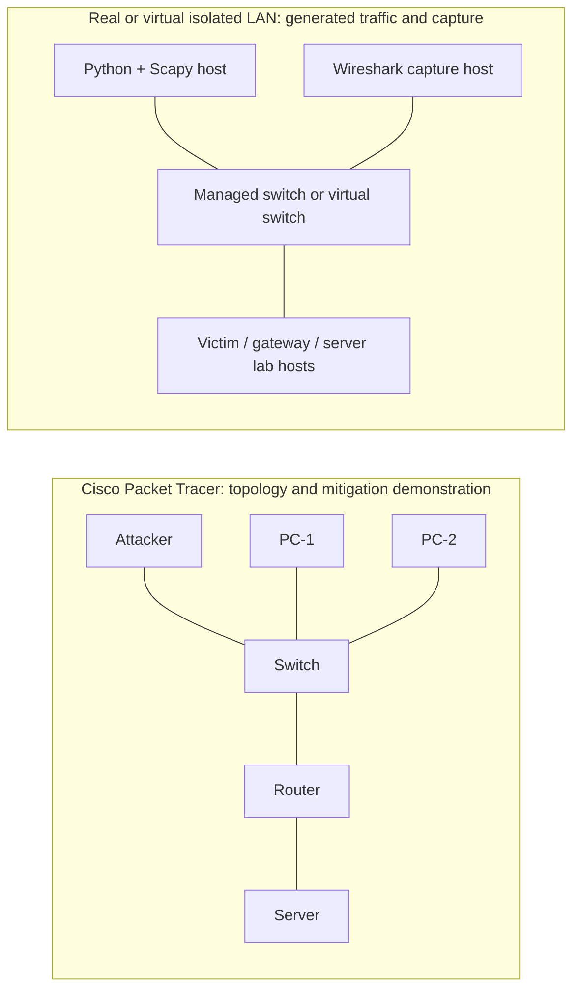

# Simulation and Mitigation of Layer 2/3 Network Attacks in an Enterprise LAN

This college project demonstrates three small, authorized network-security experiments:

| Demonstration | Cisco mitigation | Evidence to compare |
| --- | --- | --- |
| ARP cache poisoning | Static ARP entries | ARP replies and host ARP table |
| MAC address table learning pressure | Switch port security | Source MAC learning and port-security counters |
| TCP SYN traffic burst | Router ACL | SYN packets reaching or being denied before the server |

Every Python program requires a private `--lab-cidr`, checks every supplied IP against it, limits transmission to 200 packets and 60 seconds, and defaults to a dry run. It sends only after `--send` is included. Use it only on the isolated lab that you own or are authorized to operate.

## Two separate environments

Cisco Packet Tracer is a simulator. A Python program on a host operating system cannot inject packets into its simulated Ethernet links, and Wireshark cannot capture Packet Tracer's simulated frames as physical traffic. Keep the following environments separate in the report.



Build the first topology in Packet Tracer for screenshots and IOS configuration evidence. Build the second as a real or virtual Ethernet LAN for Scapy and Wireshark evidence. The usable connection is an actual Layer-2 path: for example, a Linux or macOS VM with a **bridged** NIC connected to an isolated physical managed switch, or VMs connected to an isolated virtual switch/host-only network. Put the Scapy NIC, test hosts, and capture NIC in the intended VLAN. For MAC and ARP demonstrations they must share the same broadcast domain. Configure a SPAN/mirror port to the Wireshark host if the switch does not otherwise expose the frames.

For the ACL experiment, place the Scapy host in an attacker VLAN and the server in a different server VLAN. The gateway/router is then the Scapy host's L2 next hop, so the router sees the TCP packets before the server. Do not connect the Scapy NIC to a campus or home production LAN.

## Suggested addressing plan

Packet Tracer and the real/virtual lab may use the same documentation addresses, but they remain separate networks. Substitute the actual MAC addresses shown by each environment.

| Node | VLAN / role | IPv4 | Example MAC |
| --- | --- | --- | --- |
| PC-1 / victim | Users VLAN 10 | `192.168.56.10/24` | `02:00:00:00:00:10` |
| PC-2 | Users VLAN 10 | `192.168.56.20/24` | `02:00:00:00:00:20` |
| Gateway interface | VLAN 10 | `192.168.56.1/24` | `02:00:00:00:00:01` |
| Python attacker | VLAN 20 | `192.168.57.50/24` | use the selected NIC's real MAC |
| Attacker gateway | VLAN 20 | `192.168.57.1/24` | `02:00:00:00:01:01` |
| Server | Server VLAN 30 | `192.168.58.10/24` | `02:00:00:00:02:10` |

For the ARP and MAC experiments, use a single private CIDR such as `192.168.56.0/24` and connect the Python host to VLAN 10. For the routed SYN experiment, declare a wider private CIDR such as `192.168.56.0/22`; it contains VLANs 10, 20, and 30 above.

## Installation and prerequisites

Use Python 3.10 or later. Raw Ethernet transmission needs an elevated shell: `sudo` on Linux/macOS. On Windows, install Npcap and start an elevated terminal. The programs perform validation before asking for those privileges, so a dry run is safe without elevation.

```bash
cd enterprise-lan-security
python3 -m venv .venv
. .venv/bin/activate
python -m pip install -r requirements.txt
cd python_attacks
python arp_spoof.py --help
```

Find the actual interface name before sending. `ip link` is useful on Linux and `networksetup -listallhardwareports` is useful on macOS. Confirm the interface IP/MAC and each peer's IP/MAC using the operating system, the switch table, or `arp -a`. Do not guess these values.

## Program reference

### `python_attacks/common.py`

This shared module is imported by the three programs; it has no standalone run command.

- `add_lab_arguments()` adds explicit interface, CIDR, count, interval, duration, and `--send` options.
- `parse_lab_network()` and `validate_lab_ip()` accept only private IPv4 hosts inside the declared lab CIDR.
- `validate_mac()`, `validate_interface()`, `validate_port()`, and `validate_bounds()` reject malformed MACs, a loopback interface, invalid ports, and unbounded plans.
- `run_plan()` sends a finite number of packets, stops on the duration limit, and catches Ctrl+C.
- `require_capture_privileges()` stops a real send when raw-packet privilege is unavailable.

### `python_attacks/arp_spoof.py`

`make_attack_packets()` forms two ARP reply frames: one tells the victim that the gateway IP has the attacker's MAC, and one tells the gateway that the victim IP has that MAC. `make_restoration_packets()` forms the legitimate replies for the optional cleanup. The outer loop has a count and time limit; Ctrl+C exits the loop and then, with `--restore`, sends three legitimate reply pairs.

Run this only when the Python host, victim, and gateway are in the same isolated VLAN:

```bash
cd enterprise-lan-security/python_attacks
sudo ../.venv/bin/python arp_spoof.py \
  --interface eth0 --lab-cidr 192.168.56.0/24 \
  --victim-ip 192.168.56.10 --victim-mac 02:00:00:00:00:10 \
  --gateway-ip 192.168.56.1 --gateway-mac 02:00:00:00:00:01 \
  --count 8 --interval 0.5 --max-duration 10 --restore --send
```

Expected terminal output is similar to:

```text
[12:00:00] ARP demonstration: the attacker temporarily advertises itself for each peer's IP mapping.
[12:00:00] Plan: 8 paired advertisements at 0.50s intervals (maximum 10.00s).
[12:00:04] Stopped after 8 paired rounds (16 ARP replies) in 3.51s.
[12:00:04] Restoration sent: three legitimate ARP reply pairs.
```

Take a Wireshark screenshot using `arp` before and during the run, plus a terminal screenshot. Save captures as `captures/arp_before.pcapng` and `captures/arp_after.pcapng`; the latter should show the static-ARP protection or restoration effect.

### `python_attacks/mac_flood.py`

`random_lab_mac()` makes locally administered unicast MAC addresses (`02:...`) rather than copying a vendor's address. `make_frame()` puts one random source MAC in each Ethernet frame. The program has no IP destination because switch MAC learning is Layer 2; its required `--lab-cidr` still declares the private lab scope and `--destination-mac` makes the Ethernet destination explicit.

```bash
cd enterprise-lan-security/python_attacks
sudo ../.venv/bin/python mac_flood.py \
  --interface eth0 --lab-cidr 192.168.56.0/24 \
  --destination-mac ff:ff:ff:ff:ff:ff \
  --count 30 --interval 0.1 --max-duration 5 --send
```

Expected terminal output:

```text
[12:05:00] MAC-table demonstration: each frame has a new locally administered source MAC address.
[12:05:00] Plan: 30 frames at 0.10s intervals (maximum 5.00s).
[12:05:03] Stopped after 30 Ethernet frames in 2.91s.
```

Capture with the Wireshark display filter `eth.type == 0x88b5` and take switch CLI screenshots of `show mac address-table` and `show port-security interface fa0/3`. Save packet captures as `captures/mac_before.pcapng` and `captures/mac_after.pcapng`.

### `python_attacks/syn_flood.py`

`make_syn()` builds a normal TCP SYN with an incrementing source port and a random sequence number. It does not spoof an address: `--source-ip` must equal the IPv4 address currently configured on `--interface`. The frame goes to `--next-hop-mac`, which is the router's local VLAN interface for a routed server or the server MAC when it is on the same subnet. The program sends a small rate-limited sequence and exits on its count, duration limit, or Ctrl+C.

```bash
cd enterprise-lan-security/python_attacks
sudo ../.venv/bin/python syn_flood.py \
  --interface eth0 --lab-cidr 192.168.56.0/22 \
  --source-ip 192.168.57.50 --next-hop-mac 02:00:00:00:01:01 \
  --server-ip 192.168.58.10 --destination-port 8080 \
  --source-port-start 40000 --count 20 --interval 0.2 --max-duration 6 --send
```

Expected terminal output:

```text
[12:10:00] TCP SYN demonstration: rate-limited SYN packets will be sent only to the designated lab server.
[12:10:00] Lab: 192.168.56.0/22; interface: eth0; source: 192.168.57.50; server: 192.168.58.10:8080
[12:10:04] Stopped after 20 TCP SYN packets in 3.81s.
```

Capture with `tcp.flags.syn == 1 && tcp.flags.ack == 0 && ip.dst == 192.168.58.10`. Take screenshots of that filter, the terminal, and the router ACL counters. Save captures as `captures/syn_before.pcapng` and `captures/syn_after.pcapng`.

## Test sequence and Cisco mitigation

Record the initial configuration and baseline connectivity first. Use a small count while checking that Wireshark sees traffic. Each “before” and “after” run uses the same command and values, so the comparison is fair.

### 1. ARP demonstration and static ARP

1. In Packet Tracer, put the attacker, PC-1, PC-2, and gateway interface in the same VLAN/subnet. Screenshot the topology and PC-1's initial ARP table.
2. In the real/virtual VLAN, start Wireshark on the mirror port or target host, then run `arp_spoof.py` with the example adjusted to real values. Record ARP replies and PC-1's table.
3. Add static ARP for the gateway on PC-1. Packet Tracer PC command prompts commonly accept the following form; verify it in the installed Packet Tracer version:

   ```text
   arp -s 192.168.56.1 02:00:00:00:00:01
   ```

   On a Cisco IOS router, static ARP entries use this form (MAC uses dotted Cisco notation):

   ```text
   enable
   configure terminal
   arp 192.168.56.10 0200.0000.0010 arpa
   end
   show arp
   ```

4. Run the same bounded program with `--restore`. Screenshot the fixed/static table, then save the after capture and notes in `results/after_mitigation/`.

### 2. MAC demonstration and switch port security

1. Connect the Python attacker lab NIC to an access port, for example `FastEthernet0/3`. Before mitigation, run `mac_flood.py` and observe the different `02:...` source addresses in Wireshark and the switch learning table.
2. Configure port security on the exact attacker-facing access port:

   ```text
   enable
   configure terminal
   interface fastethernet0/3
    switchport mode access
    switchport port-security
    switchport port-security maximum 1
    switchport port-security mac-address sticky
    switchport port-security violation restrict
   end
   show port-security interface fastethernet0/3
   show port-security address
   ```

3. Clear dynamically learned addresses or restart the isolated lab port if needed, then repeat the same small run. The expected after result is a port-security violation/counter and frames from new source MACs being restricted. Take screenshots before and after the command output and copy observations to `results/before_mitigation/` and `results/after_mitigation/`.

### 3. SYN traffic and router ACL

1. Place attacker and server in distinct routed VLANs. Confirm ordinary connectivity to the server's test TCP service on port `8080`, then run the bounded `syn_flood.py` command and capture it.
2. Apply an extended ACL inbound on the router interface facing the attacker VLAN. Substitute the real source, server, port, and interface. This simple lab ACL blocks TCP to the test service from the designated attacker host, so it also blocks that host's normal TCP access to that one service during the test.

   ```text
   enable
   configure terminal
   ip access-list extended LAB-SYN-GUARD
    deny tcp host 192.168.57.50 host 192.168.58.10 eq 8080
    permit ip any any
   interface gigabitethernet0/1.20
    ip access-group LAB-SYN-GUARD in
   end
   show access-lists LAB-SYN-GUARD
   ```

3. Repeat exactly the same small SYN command. The router ACL deny counter should increase and the server-side capture should no longer show the packets. Screenshot `show access-lists LAB-SYN-GUARD`, Packet Tracer's router configuration, and the before/after Wireshark views.

## Deliverables checklist

Put the six `.pcapng` files in `captures/`. Put terminal logs, a short table of configured values, and before/after observations in the two `results/` folders. Put screenshots of the Packet Tracer topology, addressing, mitigation commands, relevant switch/router `show` output, Wireshark filters, and each script's terminal result in `screenshots/`.

For the viva, explain the boundary clearly: Packet Tracer validates the intended topology and Cisco configuration; the separate real/virtual LAN provides genuine Ethernet frames for Scapy and Wireshark. Packet Tracer cannot natively execute Scapy packets, emulate every IOS feature or real switch hardware limit, or produce physical-interface Wireshark captures. State the Packet Tracer version, OS, Python/Scapy version, virtual-switch or physical-switch model, and all packet counts in the final report.
